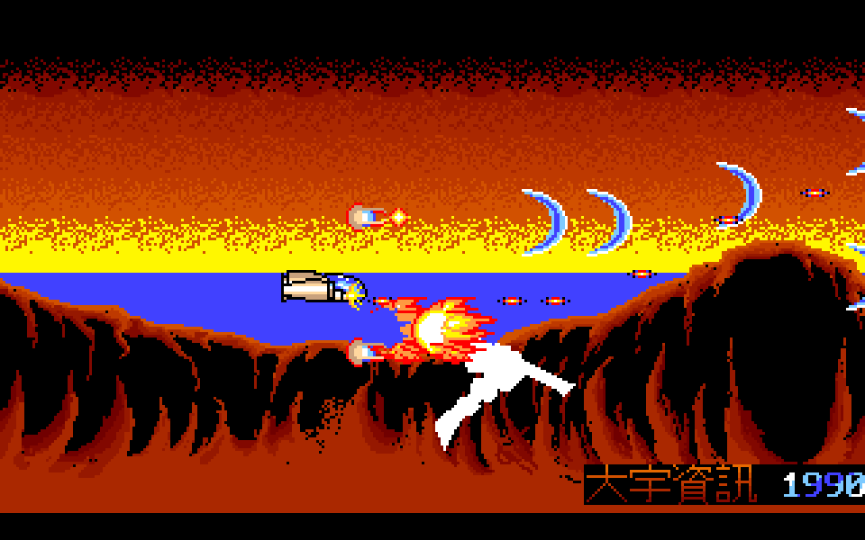
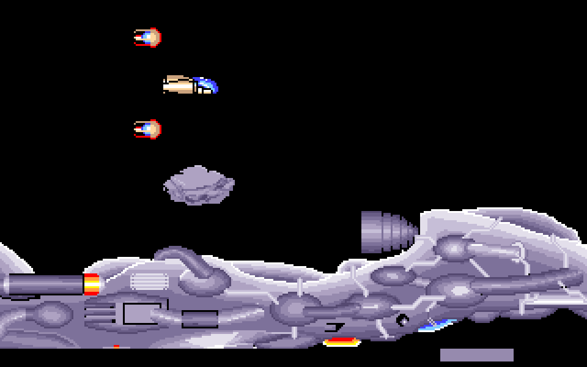
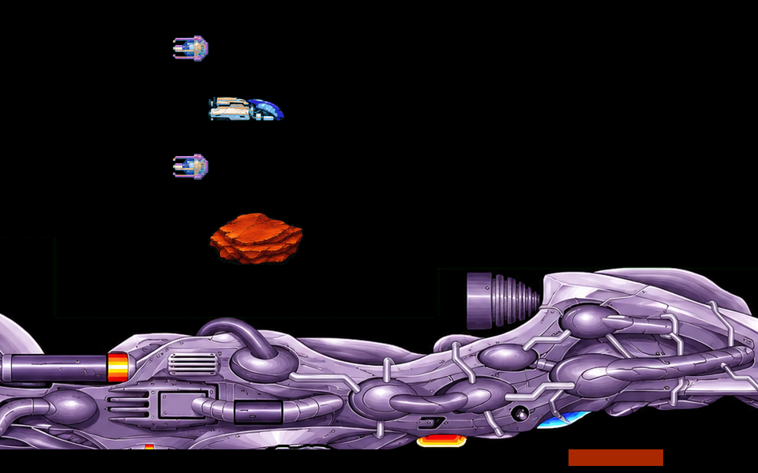
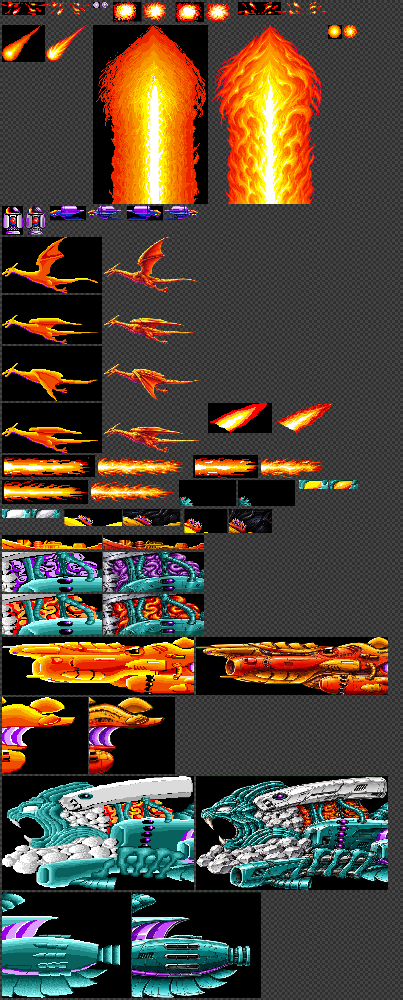
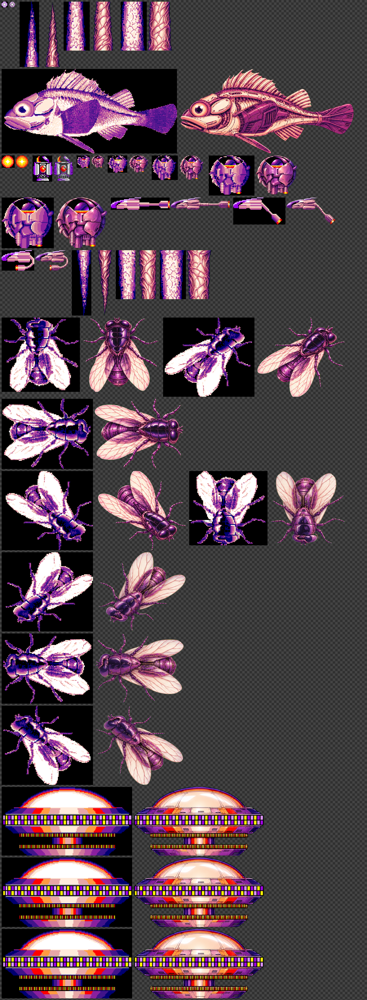
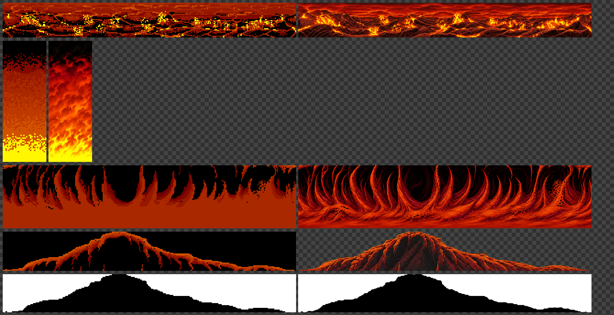
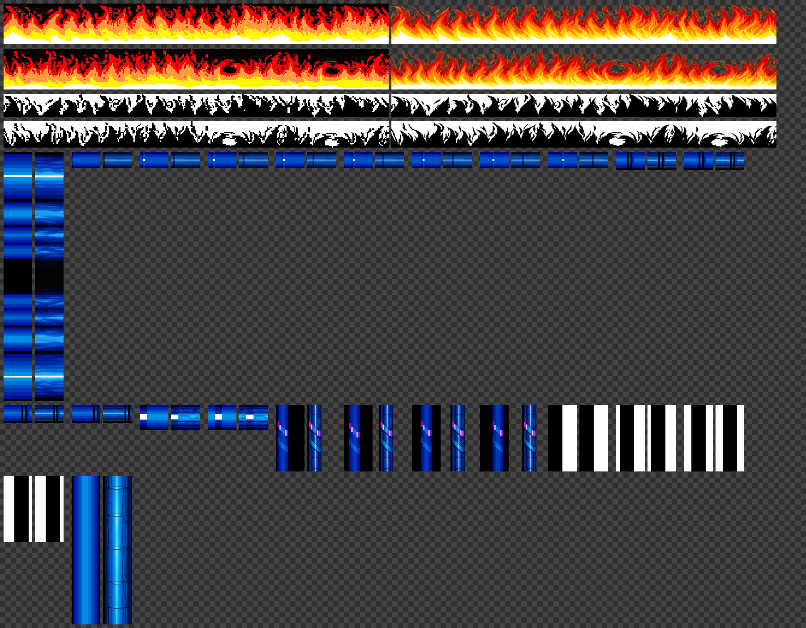
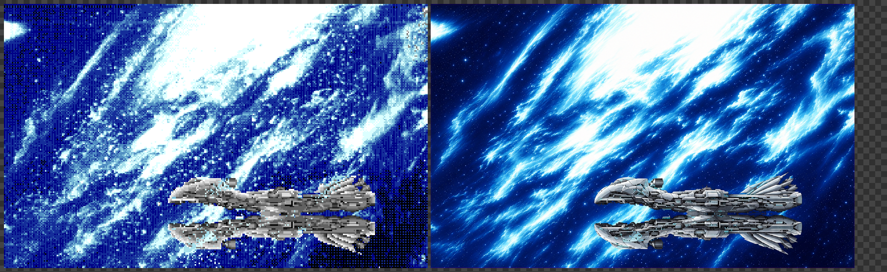
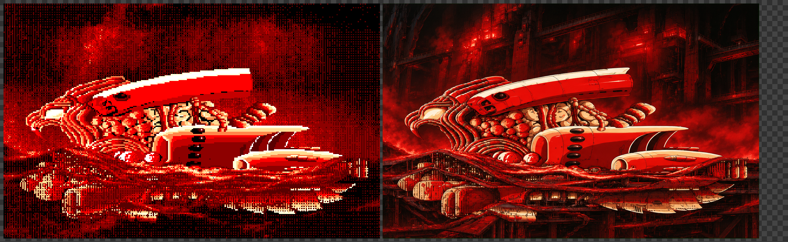
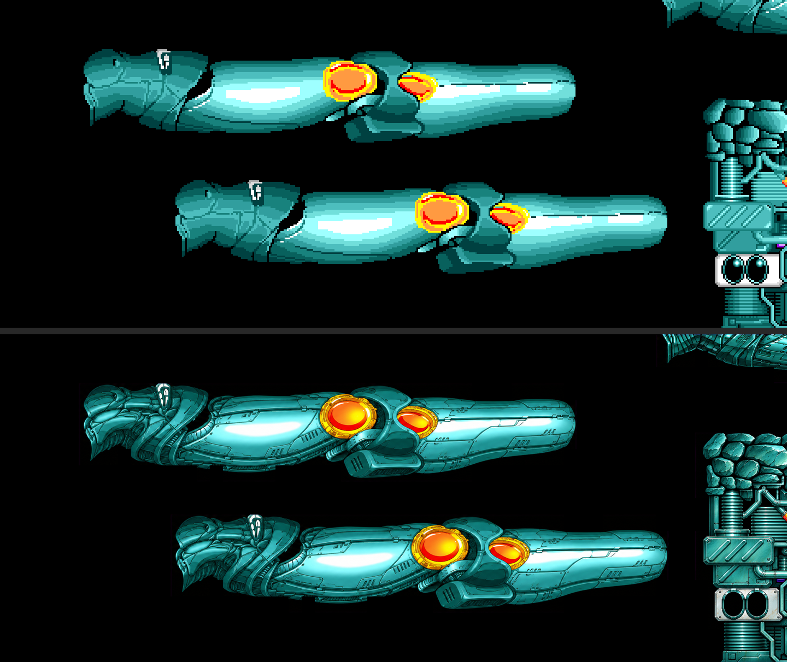

# RS-2 保存與重製

大宇資訊（Softstar）1990 年 DOS 橫向捲軸射擊遊戲《RS-2》的逆向分析、素材解析工具與 Rust 重製。目的是保存台灣早期遊戲的製作成果與技術細節。

## 原版素材

本儲存庫不含原版的執行檔、資料檔與音樂，也不含抽出的單張圖片與音訊。例外是 `docs/images/` 的原版與 HD 對照圖，裡面有各素材庫的完整總覽，所以這個 repo 維持私人，不公開。

要跑工具，請自備原版，放在 `RS-2_DOS_EN.zip`，工具會核對雜湊。`tools/leak_check.py` 在推送前檢查有沒有夾帶，圖片只放行 `docs/images/` 這個路徑。

分析用的這一份是破解組 Future Brain Inc. 的 BBS 發行版。破解補丁與 intro 只當史料記錄，不當原版行為，也不進重製。

## 這款遊戲

玩家駕駛戰機橫向推進四關，每關結尾打頭目。可單人（兩種機體）或雙人同時遊玩，有四段難度。沒有分數、生命數或接關，血量每次被打中減半，而且跨關保留。

它支援 VGA、EGA、CGA 與 MGA 四種顯示模式，CGA／MGA 有獨立的單色圖庫，音樂走 AdLib，音效走 PC 喇叭，還有大宇自己的 JOYMOUSE 搖桿介面工具。

《電腦玩家》1992 年 5 月的大宇專題把它列為施文馮的作品，稱其在技術上有長足進步。遊戲內的製作名單也寫著程式設計施文馮。

## 素材：原版與 HD

全部 1,337 個圖庫索引都有 HD 版，解析度是原版的 4 倍，畫風是賽璐璐加噴槍。其中 278 張與第三關的 1,013 個圖塊由 Codex 重繪。製作者署名與公司標誌共 4 張不交給生成模型，用 EPX 演算法放大。其餘是由重繪結果推導的位移圖、遮罩與佔位圖。

下面的圖放在 `docs/images/`，由 `tools/readme_images.sh` 產生。

### 遊戲畫面

這些是重製實際合成的畫面，左右兩張來自同一批繪製命令。原版圖模式與 DOS 原版的顯示記憶體逐位元組相同。

| 場景 | 原版 | HD |
|---|---|---|
| 第一關捲動。敵機被打中時閃白 |  |  |
| 頭目進場。調色盤已換成頭目用的配色 |  |  |
| 頭目戰 |  |  |

HD 第一關目前有這些問題，清單在 [docs/hd/codex-handoff.md](docs/hd/codex-handoff.md)：

- 山影與倒懸岩交界有水平色帶，倒懸岩與天空有接縫，頭目上翼在零件交界斷開。這些要重畫。
- 頭目進場時，漂浮岩塊與血條還是第一關的配色，原版會跟著換色。

### 各素材庫

每組左邊是原版，右邊是 HD。

<details>
<summary><code>MY</code>：玩家機、子彈、爆炸、介面字樣、標題與署名（86 項）</summary>


</details>

<details>
<summary><code>SHT1</code>：第一關的敵人與頭目（36 項）</summary>


</details>

<details>
<summary><code>SHT2</code>：第二關的敵人與頭目（36 項）</summary>


</details>

<details>
<summary><code>SHT3</code>：第三關的敵人與頭目（44 項）</summary>


</details>

<details>
<summary><code>SHT4</code>：第四關的敵人與頭目（35 項）</summary>


</details>

<details>
<summary><code>SHT5</code>：片尾（5 項）</summary>


</details>

<details>
<summary><code>BH1</code>：第一關背景（5 項）</summary>


</details>

<details>
<summary><code>BH2</code>：第二關背景（28 項）</summary>


</details>

<details>
<summary><code>BH4</code>：第四關背景（1 項）</summary>


</details>

<details>
<summary><code>BEG1</code>：開場（32 項）</summary>


</details>

<details>
<summary><code>J1</code> 至 <code>J4</code>：關間過場（共 10 項）</summary>





</details>

<details>
<summary><code>MAP</code>：第三關地圖圖塊（1,019 項）。上方是原版，下方是 HD，只取地圖橫向 1200 到 1680 像素這一段</summary>


</details>

CGA 與 MGA 的單色版另有 1,526 張，由 HD 彩色圖推導，這裡沒有列出。

## 現況

| 部分 | 狀態 |
|---|---|
| 檔案格式 | 全部解出，工具重建結果可重現 |
| 遊戲邏輯 | 靜態讀碼完成，未解項列在 `WORKLIST.md` |
| 原版實跑 | dosgolem 走通冷啟動、四關與片尾，第一關頭目已實際擊殺 |
| HD 圖像 | 全部索引都有輸出。單張成品只留本機，`docs/images/` 有對照圖。第一關已接入重製，接縫與部分配色待修 |
| Rust 重製 | 第一關可玩，模擬與原版逐幀相同，原版圖模式的畫面逐位元組相同。等真人試玩。還沒有音樂與音效，第二到第四關未開始 |

唯一現況入口是 [CONTEXT.md](CONTEXT.md)。

## 試玩第一關

需要 Docker、X11 桌面，以及自備的原版。先跑過 `tools/run_all.sh`。

```sh
tools/rust.sh play-build
tools/rust.sh play              # 有 workspace/hd/assets 就用 HD，加 --no-hd 改原版圖
```

方向鍵移動，Home、PgUp、End、PgDn 是斜向。右 Shift 開火，`/` 砲座轉向，Esc 暫停，Ctrl+Q 離開。F1 切補間，F2 切幀計數，F3 切原版圖與 HD，F4 切視窗倍率，F10 隱藏工具列。

## 重要發現

| 發現 | 文件 |
|---|---|
| `S.EXE` 是兩層 LZEXE 夾一段破解組 intro，密碼檢查已被 7 位元組補丁固化 | [01](docs/re/01-boot-chain.md) |
| 圖庫是 RLE 壓縮的索引表，彩色圖第一個平面區段是最高位，遮罩獨立成庫 | [02](docs/re/02-file-formats.md) |
| 邏輯更新率是每秒 9.10 次，AdLib 驅動改寫 PIT 但以累加器轉發原頻率 | [10](docs/re/10-dynamic-receipts.md) |
| 敵人由幀計數時間表生成，移動腳本是位元組碼，亂數是固定表 | [11](docs/re/11-entities-combat.md) |
| 頭目由合成圖、隱藏碰撞體與可見分件組成 | [12](docs/re/12-stages-presentation.md) |
| 音樂格式與 OPL2 暫存器逐欄對照，可轉成 VGM（尚未與原版逐筆比對） | [13](docs/re/13-audio-and-misc.md) |

## 重建分析結果

需要 Docker。下列指令只在容器內處理資料，輸出落在不進版控的 `original/` 與 `workspace/`。

```sh
tools/run_all.sh        # 解壓、解包、抽素材、匯出表格
tools/ida_export.sh     # 需要本機 IDA 9.4 映像
tools/run_all.sh        # 有 IDA 匯出才會產生素材用途表
```

動態收據的重跑方式見 [docs/re/10-dynamic-receipts.md](docs/re/10-dynamic-receipts.md)，HD 流程見 [docs/hd/codex-handoff.md](docs/hd/codex-handoff.md)。

## 文件

| 檔案 | 內容 |
|---|---|
| [AGENTS.md](AGENTS.md) | 工作規則、證據等級、邊界 |
| [CONTEXT.md](CONTEXT.md) | 現況、決策、術語 |
| [WORKLIST.md](WORKLIST.md) | 待辦 |
| [docs/re/](docs/re/) | 逆向文件 |
| [docs/spec/](docs/spec/) | 重製規格 |
| [docs/hd/](docs/hd/) | HD 素材 |
| [crates/](crates/) | Rust 重製 |

## 授權

採 RRSAL-1.0（復古重製 source-available 授權條款），全文見 [LICENSE](LICENSE)。非商業用途免費，實況與影片明示允許，商業用途請洽談。條款不涵蓋原版素材，也不涵蓋 `docs/images/` 的對照圖與 HD 圖。

本專案與大宇資訊沒有隸屬、合作、贊助或授權關係。原版的權利屬於各自的權利人，權利現況未查證。
