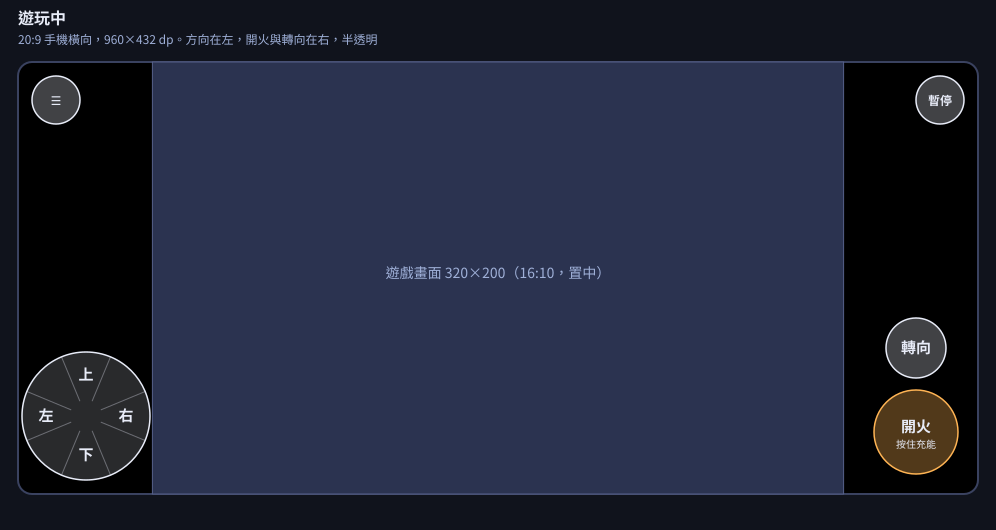
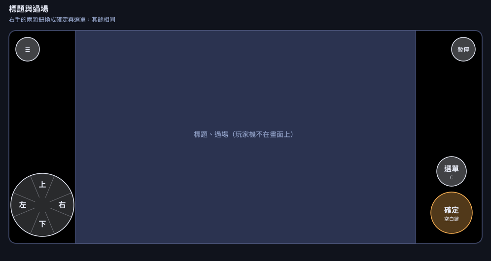
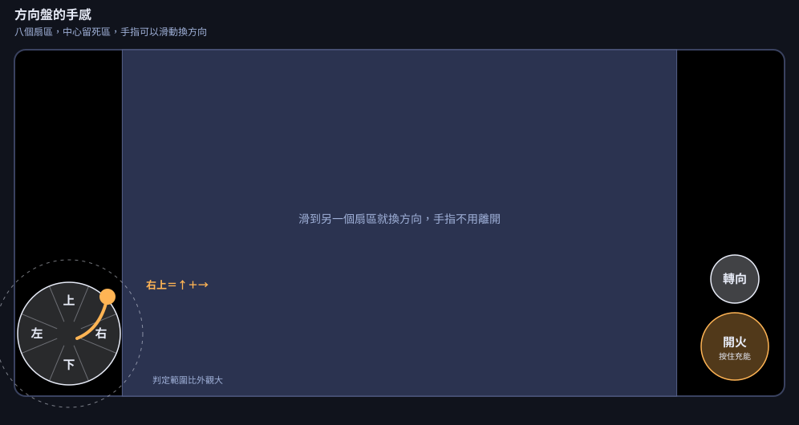
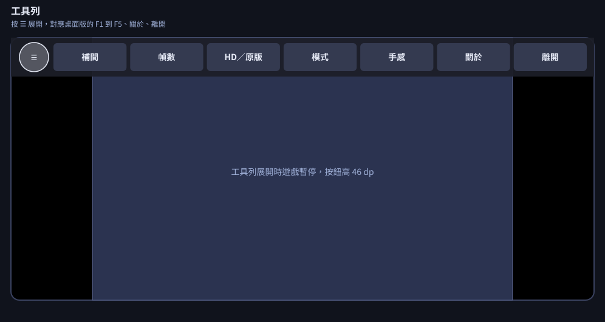
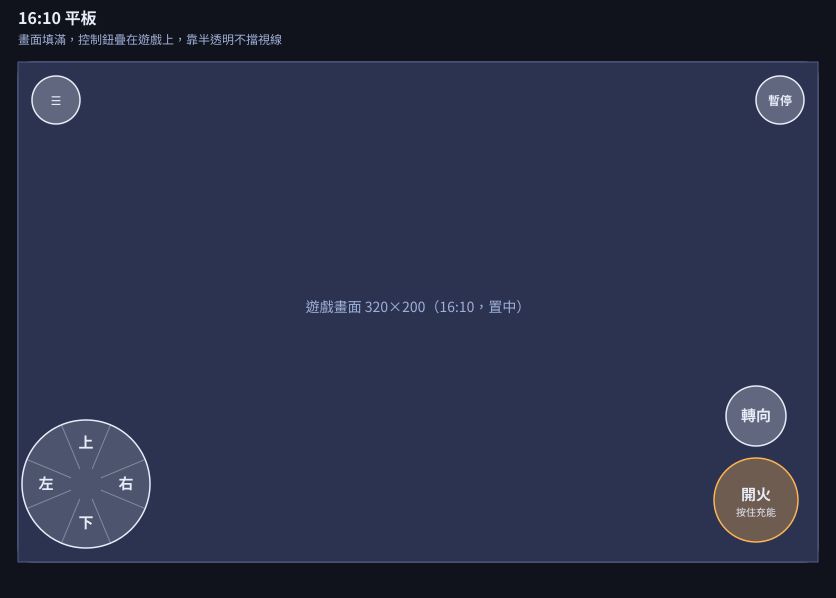

# Android 觸控版面

遊戲只用少數幾個鍵，所以觸控層只把手指換成按鍵事件，交給和桌面相同的 `InputMapper`。遊戲核心沒有 Android 專用的程式碼。

設計稿由 `tools/android_mockups.py` 產生，尺寸和 `crates/rs2-play/src/touch.rs` 相同，單位是 dp。

## 遊戲用到的鍵

來源是 `docs/re/03-game-logic.md`「輸入」「熱鍵」。

| 動作 | 鍵 | 觸控 |
|---|---|---|
| 移動 | 方向鍵、Home、PgUp、End、PgDn | 左下方向盤，八個扇區 |
| 開火，按住充能 | 右 Shift | 右下大鈕 |
| 砲座轉向 | `/` | 開火鈕上方 |
| 暫停 | Esc | 右上 |
| 標題開選單 | C | 不在遊玩時，轉向鈕變成「選單」 |
| 選單確認、開始遊戲 | 空白鍵 | 不在遊玩時，開火鈕變成「確定」 |
| 靜音 | S | 工具列沒有，手機用系統音量 |
| 回標題、離開 | Ctrl+R、Ctrl+Q | 工具列的 QUIT，走系統的離開流程 |

雙人模式要第二個輸入裝置。手機上接兩支藍牙手把，或一支手把加觸控，對應方式見 `crates/rs2-play/src/pad.rs`。

## 遊玩中

20:9 手機橫向是 960×432 dp。16:10 的遊戲畫面置中後，左右各留 134 dp。右手的按鈕都在留白內，方向盤只有邊緣疊到遊戲，半透明。

| 控制 | 中心 | 外觀半徑 | 判定半徑 |
|---|---|---|---|
| 方向盤 | 左下 (68, h-78) | 64 | 92 |
| 開火 | 右下 (w-62, h-62) | 42 | 52 |
| 轉向 | 開火鈕上方 (w-62, h-146) | 30 | 38 |
| 暫停 | 右上 (w-38, 38) | 24 | 32 |
| 工具列 | 左上 (38, 38) | 24 | 32 |

最小的按鈕直徑 48 dp。

## 標題與過場

判斷依據是 `Session` 的玩家機狀態：這一幀有畫玩家機而且可以控制就是遊玩中。兩種狀態只換右手兩顆鈕的鍵與文字，位置不變。

## 方向盤的手感

- 手指放下後綁定方向盤，直到離開螢幕。滑出外觀範圍仍然有效。
- 中心 14 dp 是死區。其餘依角度分八個扇區，斜向送兩個鍵。遊戲看到的是按鍵狀態，所以 ↑ 加 → 和 PgUp 同樣斜向走。
- 滑到另一個扇區時，先放開不再用的鍵，再按新的鍵。

## 工具列

按 ☰ 展開，和桌面版同一條工具列，字樣不帶 F 鍵。手機上預設隱藏。展開時遊戲畫面往下移，不暫停遊戲。

| 按鈕 | 作用 |
|---|---|
| TWEEN | 畫面補間 |
| COUNT | 幀計數 |
| HD／ORIG | HD 與原版圖 |
| FEEL | 玩家機預測與短按保留，ORIG 是原版時序 |
| ABOUT | 開授權與製作資訊的頁面 |
| QUIT | 離開 |

倍率按鈕在手機上沒有用途，不顯示。

## 平板

16:10 平板沒有左右留白，控制鈕全部疊在遊戲上。

## 生命週期與檔案

| 項目 | 做法 |
|---|---|
| 方向 | Manifest 鎖橫向 |
| 資料 | 原版檔與 HD 放 APK 的 `assets/rs2-data.pak`，第一次啟動解到內部儲存，逐檔驗 SHA-256。解完才進遊戲，已經解過而且雜湊相符就略過 |
| 路徑 | `SDL_GetPrefPath` 在 Android 回傳內部儲存，設定與資料都放那裡。不用 cwd |
| 切到背景 | SDL 預設在背景停住事件迴圈。回前景時重設 `Pacer`，不補步。遊戲等於暫停 |
| 系統設定變更 | Manifest 宣告自己處理字型大小、顯示大小、深色模式等，Activity 不重建。資源路徑變更（`assetsPaths`）無法宣告，發生時 Activity 重建，遊戲從標題重來 |
| GL context 遺失 | 收到 `RenderDeviceReset` 或 `RenderTargetsReset` 時重建貼圖 |
| 授權 | `SDL_OpenURL("rs2about://license")` 開 `AboutActivity`，顯示 `assets/LICENSE` 全文 |

## 還沒驗的項目

模擬器可以驗安裝、啟動、畫面、合成的觸控事件。下列項目要真機：實際手感、瀏海與手勢列、藍牙手把、背景切換時的音訊裝置行為。

「砲座像 Force」選項開著時，右手多一顆分離鈕，疊在轉向鈕上方（`touch.rs` 的 `layout_with`），一樣不蓋到遊戲畫面。切換選項時版面重排，按著的手指會放開。
