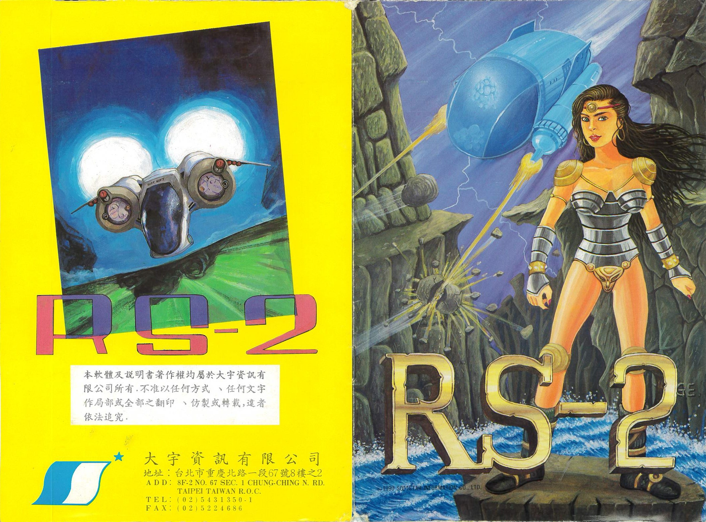
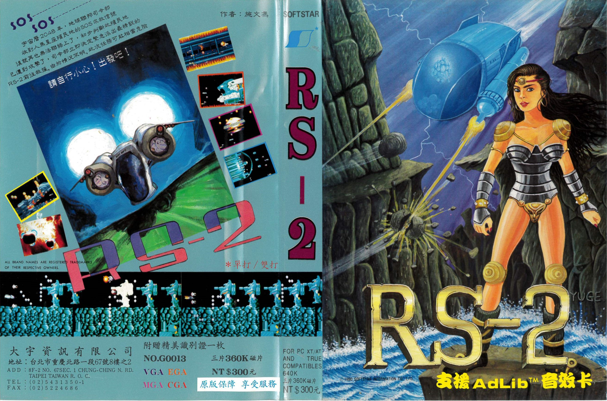
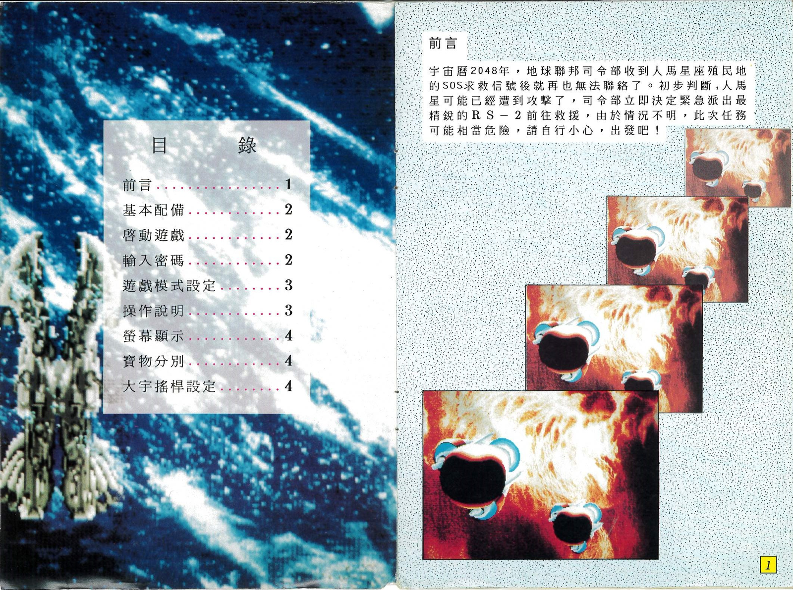
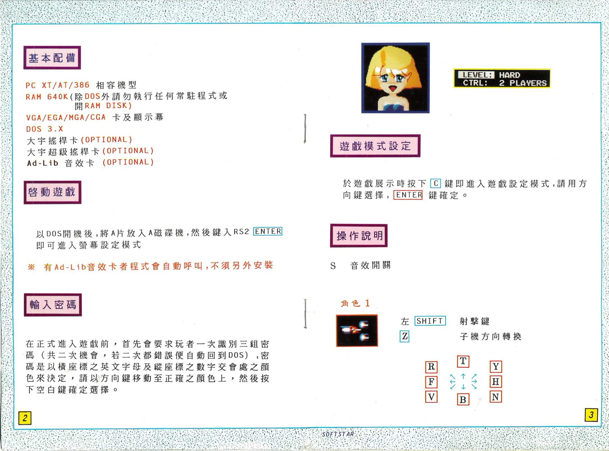
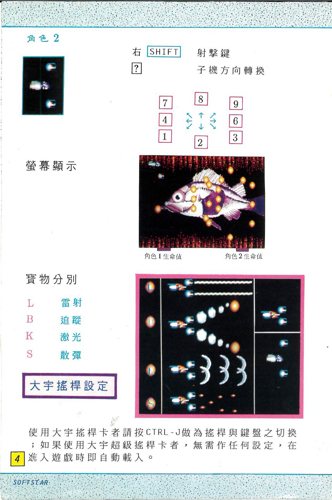
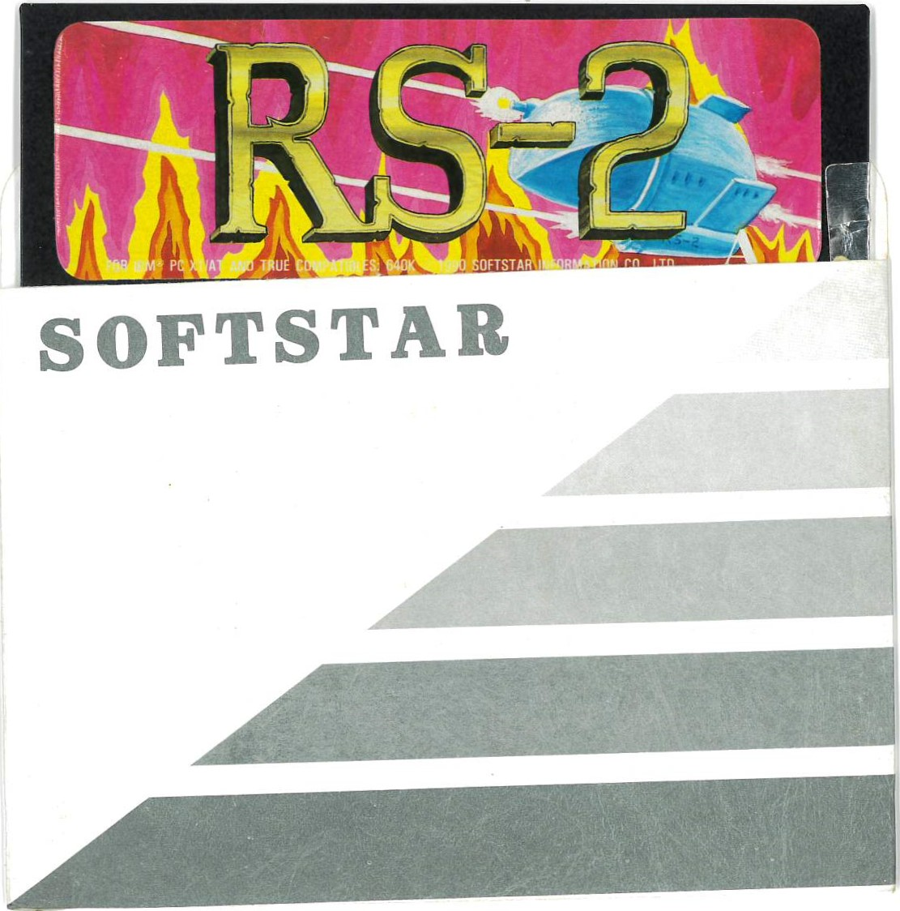
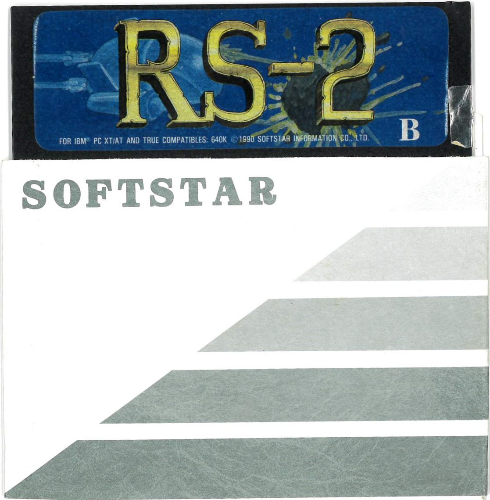
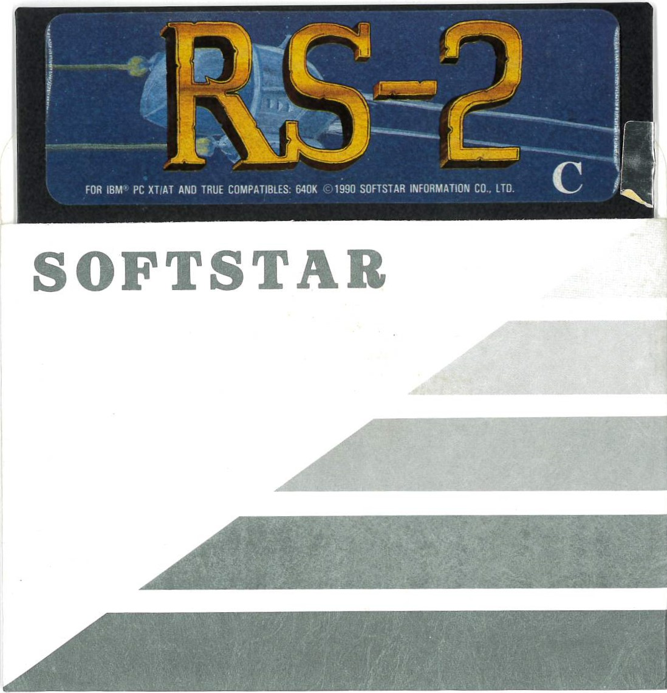

# 《RS-2》說明書

大宇資訊，1990 年。本頁依使用者提供的掃描資料整理，保留原版用語，標點與表格重新排版。這是 DOS 原版說明書的整理。重製版操作見 [README](../README.md)。

掃描資料內附骨灰集散地的「說明書掃描計劃」與來源註記，未列出個別掃描者。本頁不另猜署名。原始 JPEG 留在本機，下列 PNG 為閱讀用縮圖。圖上若有遊戲畫面，均為紙本原有截圖。

## 封面與包裝

右半是說明書封面，左半是封底。封面保留「RS-2」與 1990 年 SOFTSTAR 署名；封底印有大宇資訊的商標、公司名稱與當年聯絡資料。這些是歷史資料，不代表目前聯絡方式。

外包裝與說明書使用相同的女戰士、藍色飛船與峽谷構圖。此處僅保存掃描，不推定封面角色在遊戲內的身分。

## 目錄與故事

| 原版章節 | 頁碼 |
|---|---|
| 前言 | 1 |
| 基本配備、啟動遊戲、輸入密碼 | 2 |
| 遊戲模式設定、操作說明 | 3 |
| 螢幕顯示、寶物分別、大宇搖桿設定 | 4 |

宇宙曆 2048 年，地球聯邦司令部收到人馬星座殖民地的 SOS 求救訊號，隨後與當地失去聯繫。司令部判斷殖民地可能遭到攻擊，派出最精銳的 RS-2 前往救援。由於情況不明，任務可能相當危險。

## 基本配備

以下是紙本列出的 DOS 原版需求。

| 項目 | 說明書記載 |
|---|---|
| 電腦 | PC XT／AT／386 相容機型 |
| 記憶體 | RAM 640K；除 DOS 外，不執行常駐程式或開 RAM DISK |
| 顯示 | VGA／EGA／MGA／CGA 卡及顯示幕 |
| 作業系統 | DOS 3.X |
| 選用配備 | 大宇搖桿卡、大宇超級搖桿卡、Ad-Lib 音效卡 |

## 啟動與遊戲模式

1. 以 DOS 開機，將 A 片放進 A 磁碟機。
2. 輸入 `RS2`，按 `Enter`，進入螢幕設定。
3. 有 Ad-Lib 音效卡時，程式會自動呼叫，不需另外安裝。
4. 遊戲展示時按 `C` 進入遊戲設定，以方向鍵選擇，按 `Enter` 確定。

原版在正式進入遊戲前會要求辨認密碼。本專案不刊載密碼表、查表內容或答案，因此第 5 張掃描僅保留左頁；這不是掃描缺頁。

紙本設定截圖顯示 `LEVEL: HARD` 與 `CTRL: 2 PLAYERS`。這是截圖當時的選擇，不能據此認定原版預設難度或人數。

## 操作說明

`S` 為音效開關。角色 1 與角色 2 可使用不同鍵區同時遊玩。

| 功能 | 角色 1 | 角色 2 |
|---|---|---|
| 射擊 | 左 `Shift` | 右 `Shift` |
| 子機方向轉換 | `Z` | 紙本標示 `?` |
| 上 | `T` | 數字鍵盤 `8` |
| 下 | `B` | 數字鍵盤 `2` |
| 左 | `F` | 數字鍵盤 `4` |
| 右 | `H` | 數字鍵盤 `6` |
| 左上 | `R` | 數字鍵盤 `7` |
| 右上 | `Y` | 數字鍵盤 `9` |
| 左下 | `V` | 數字鍵盤 `1` |
| 右下 | `N` | 數字鍵盤 `3` |

紙本把角色 2 的子機轉向鍵印成 `?`。本表保留原印字樣，不自行改成其他按鍵名稱。重製版可在「控制設定」查看或調整實際對應。

## 螢幕顯示與寶物

說明書以戰鬥截圖標出角色 1 與角色 2 的「生命值」。下方武器圖示並列四種寶物效果。

| 寶物字母 | 紙本名稱 |
|---|---|
| L | 雷射 |
| B | 追蹤 |
| K | 激光 |
| S | 散彈 |

「雷射」與「激光」是原版紙本分別使用的名稱，本頁照錄。武器的傷害、碰撞與持續時間不由這張圖推定，相關研究見 [實體與戰鬥](re/11-entities-combat.md)。

## 大宇搖桿設定

- 大宇搖桿卡：按 `Ctrl+J`，切換搖桿與鍵盤。
- 大宇超級搖桿卡：不需另作設定，進入遊戲時自動載入。

以上適用於原版周邊。重製版的現代手把設定見遊戲內「控制設定」。

## 售後服務史料

第 5 張掃描右頁下方記載：非磁片本身損毀而無法使用時，可寄回代為拷貝；磁片本身損毀時，當年的處理方式是附每片 50 元工本費，寄回後重製原版磁片。寄送說明另要求使用厚紙板或磁片整理盒保護，註明姓名、地址、電話、故障原因並附 30 元。

這是紙本當年的服務記載，不代表目前仍提供此服務。右頁上方的密碼表不收錄。

## 三片磁片

| A 片 | B 片 | C 片 |
|---|---|---|
|  |  |  |

這三張是磁片外觀掃描，並非磁片映像。照片不能證明磁片內容完整，也不等於已取得未破解的程式。

## 來源與保存方式

- 使用者提供：`大宇資訊-RS2.rar`，2026-11-11 加入本專案。
- RAR SHA-256：`a28beac84835d62d7d1f1161bfa4d1d13fc6386e66c481a1ddc6ef30fdb84c15`。
- JPEG 名稱共同前綴：`BP-70C45_20261111_084103_`。
- 整理工具：[manual_extract.py](../tools/manual_extract.py) 與 [manual_images.py](../tools/manual_images.py)。前者以 `libarchive.so.13` 釘住輸入並安全解壓；後者以 Pillow 11.3.0 產生 PNG，最寬 1600 像素，不加浮水印。第 5 張原圖尺寸為 2137×1581，只保留 `x=0..1049` 的左頁。
- 來源註記署名：骨灰集散地，原附文列出 [網站](http://boneash.oldgame.tw)、[粉絲團](https://www.facebook.com/BoneAshOldGame) 與 [社團](https://www.facebook.com/groups/1659118727741582)。這些連結照來源保留，未核對目前營運狀態。
- 原附文要求不在掃描檔加其他符號、不作牟利用途。兩份原始文字檔留在本機 `workspace/manual/`，其雜湊記在同目錄 `manifest.json`。
- 本頁與插圖依使用者指示放在私人 repo。原版圖文權利仍屬原權利人，專案 RRSAL-1.0 不涵蓋原版素材。本次不改變 repo 可見度，也不授權公開散布。

| 掃描 | 內容 | 原始 JPEG SHA-256 |
|---|---|---|
| 0001 | 外包裝 | `ce938120eff8202a46ebc246e2030394ca33eb2577e6c3503cf7a3f0cec1be69` |
| 0002 | 封底與封面 | `03877d34c4d6154751d76ff31445197e9f6fe8770297cfc84802bc7b79c4d269` |
| 0003 | 目錄與前言 | `76979e6f25c65a29ef49e22482e9ed6d184dbc13f22fd4a8570b72238940d40c` |
| 0004 | 第 2 至 3 頁 | `b2f6972b5f08554dcce709eafd2031ae42185fba8432eb553188d9e6d8aedc22` |
| 0005 | 第 4 頁與密碼表、售後服務 | `bb4bfa988d06ce1aebfd766cbdc38cf0efe1210e08af127962efe217ddd8624a` |
| 0006 | A 片 | `4361526b28fb0250dabbd70b443a347d3e550fdc7dba585c4b9565b1b256e382` |
| 0007 | B 片 | `91fbc41974702b1e28ae0c21e01a0b2ff191c874ff742358d2cc305803cd2fd3` |
| 0008 | C 片 | `b35707a365d5672de37ad27e2b3893d663b3a8e73030ce5ffae7d1e32735e9ea` |

紙本可直接證實本頁的故事、設備與按鍵記載。執行時行為仍以原版程式與受控收據為準；紙本與程式若有差異，兩份證據分別保存。
